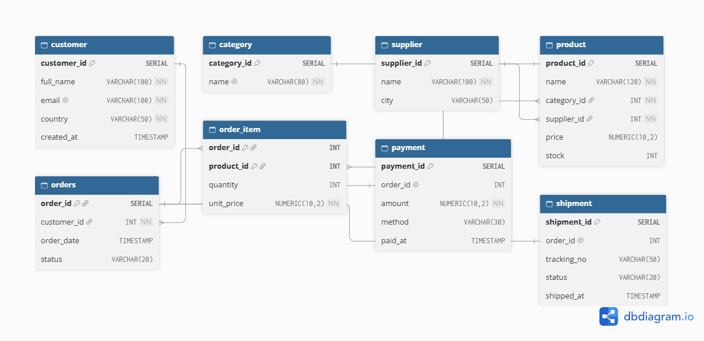

# Portfolio 1: Database Design and Modelling

## Case study
**Home of Fantasies** is an online store that sells dreamy home lifestyle products sourced from suppliers in China to customers in Africa. The database is used by customers (browsing and ordering), store admins (managing products, stock and orders) and suppliers (who provide the products). It stores customers, products, categories, suppliers, orders, order items, payments and shipments. Its key operations are adding products, placing orders, updating stock, recording payments and tracking delivery.

## Entities and relationships
The design has 8 tables (see `er-diagram.png`):

- **customer**: people who buy from the store.
- **category**: product groups, e.g. lighting or bedding.
- **supplier**: businesses that supply the products.
- **product**: items for sale, each linked to one category and one supplier.
- **orders**: one row per order placed by a customer.
- **order_item**: the products inside each order, with quantity and price.
- **payment**: the payment made for an order.
- **shipment**: delivery details for an order.

Relationships:
- One customer can place many orders (one-to-many).
- One category and one supplier can each have many products (one-to-many).
- One order can contain many products, and one product can appear in many orders (many-to-many). The `order_item` table resolves this.
- Each order has at most one payment and one shipment (one-to-one).

## Keys and constraints
- **Primary keys:** every table has an auto-numbered `SERIAL` ID. `order_item` uses a composite key (`order_id`, `product_id`), so the same product cannot appear twice in one order.
- **Foreign keys:** `product` references `category` and `supplier`; `orders` references `customer`; `order_item` references `orders` and `product`; `payment` and `shipment` reference `orders`. These keep the data consistent, so an order cannot point to a customer that does not exist.
- **UNIQUE:** customer `email` and category `name`, to prevent duplicates. `payment.order_id` and `shipment.order_id` are also unique, which enforces one payment and one shipment per order.
- **NOT NULL:** applied to essential fields such as names, email, country, `orders.customer_id`, `order_item.unit_price`, and `payment.amount`.
- **CHECK:** `price > 0`, `stock >= 0`, `quantity > 0`, and order `status` limited to pending, paid, shipped, delivered or cancelled. These stop invalid data from being stored.
- **DEFAULT:** `created_at` and `order_date` default to the current time.

## Normalisation
The design is in Third Normal Form (3NF).
- **1NF:** every column holds a single value, and every table has a primary key.
- **2NF:** in `order_item`, `quantity` and `unit_price` depend on the whole composite key (the order and the product), not on just part of it.
- **3NF:** there are no transitive dependencies. Category names live only in `category`, and supplier details live only in `supplier`, so they are not repeated on every product row. Customer details are stored once in `customer`, not in every order.

`unit_price` is deliberately stored in `order_item` as well as `product.price`. If a product's price changes later, past orders still show the price the customer actually paid.

## Design decision
At first, `category_id` and `supplier_id` in `product` were optional. While building the ER diagram in dbdiagram.io, I got warnings that the relationships assumed these columns were always filled. I decided that every product should belong to a category and a supplier, so I added `NOT NULL` to both columns in `schema.sql` and in the diagram. This prevents products with no category or supplier.

## Files and testing
- `schema.sql`: the PostgreSQL script that creates all 8 tables.
- `er-diagram.png`: the ER diagram, made in dbdiagram.io.
- Testing: I ran `schema.sql` in PostgreSQL 18 on db<>fiddle. All tables were created with no errors, and `SELECT * FROM customer;` returned the expected columns with no rows.

## AI Use Declaration
- **Tools used:** Claude (Anthropic) and GitHub Copilot.
- I planned the portfolio and drafted the starter schema and this README, Claude guided me through GitHub and dbdiagram.io.
- 
I ran the schema myself in PostgreSQL, compared the ER diagram against the SQL, fixed the NOT NULL mismatch, and edited this document to match my own understanding of the design.
